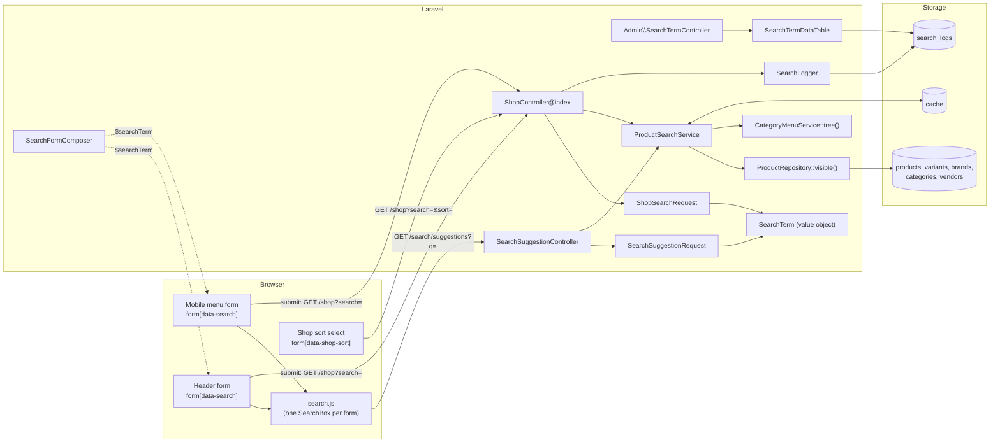
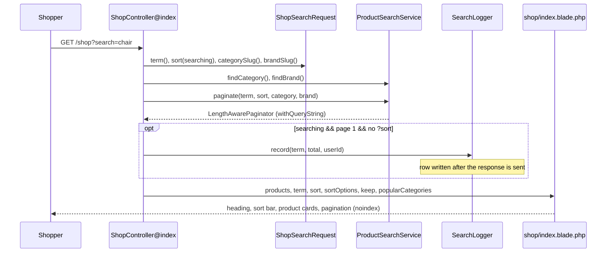
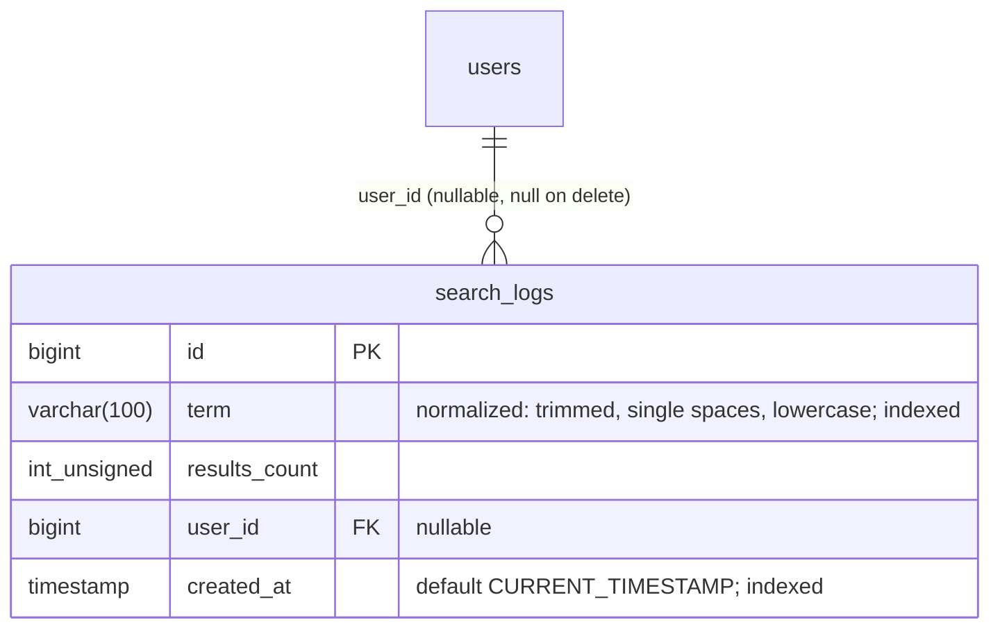
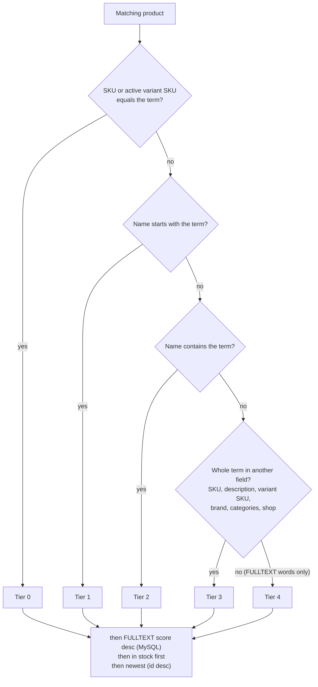

# Storefront Search Feature

Header and mobile-menu product search for the multivendor storefront: one search service, live suggestions
(AJAX autocomplete), a search results page with sorting, and a simple admin report of what customers search for.

> **Status (2026-10-30):** implemented in the working tree on top of commit `922b7d1`, **not committed yet**.
> Migrations have been run on the dev database. Full test suite: 503 passed, 2 failed — both failures existed
> before this feature (`CategoryMenuTest` "static template items", `QuickViewTest` card icons).

---

## Contents

1. [Overview](#1-overview)
2. [Existing project analysis](#2-existing-project-analysis)
3. [Architecture](#3-architecture)
4. [Database: migrations and indexes](#4-database-migrations-and-indexes)
5. [Backend classes](#5-backend-classes)
6. [Matching, ranking and validation](#6-matching-ranking-and-validation)
7. [Live suggestions (AJAX autocomplete)](#7-live-suggestions-ajax-autocomplete)
8. [Desktop and mobile search forms](#8-desktop-and-mobile-search-forms)
9. [Search results page, sorting and pagination](#9-search-results-page-sorting-and-pagination)
10. [Search analytics and the admin report](#10-search-analytics-and-the-admin-report)
11. [Routes](#11-routes)
12. [Security](#12-security)
13. [Caching and performance](#13-caching-and-performance)
14. [Testing strategy](#14-testing-strategy)
15. [Implementation roadmap](#15-implementation-roadmap)
16. [Files created and modified](#16-files-created-and-modified)
17. [Known limitations and future work](#17-known-limitations-and-future-work)
18. [Final checklist](#18-final-checklist)

---

## 1. Overview

| Piece | What it does | Entry point |
|---|---|---|
| Search service | The only place that knows how products are searched, ranked and sorted | `App\Services\ProductSearchService` |
| Live suggestions | Up to 6 products, 3 categories, 3 brands while typing | `GET /search/suggestions?q=` |
| Results page | The existing shop page, now reading `?search=&sort=&category=&brand=` | `GET /shop` (`shop.index`) |
| Forms | Template header box + mobile menu form, both `GET /shop?search=` | `header.blade.php`, `menu.blade.php` |
| Front-end behaviour | Debounce, keyboard, ARIA, recent searches, shop sort submit | `public/frontend-assets/js/search.js` |
| Analytics | One row per submitted search, admin "Search Terms" DataTable | `SearchLogger`, `/admin/search-terms` |

Design rules followed throughout:

- The storefront template's markup and classes are kept (`/template/ecommerce-frontend-template`); template CSS/JS
  files are never edited. Extra CSS lives only in `public/frontend-assets/css/custom.css`, scoped to the search
  components.
- Thin controllers, Form Requests for input, no queries in Blade (View Composer for the header term).
- Only storefront-visible products are ever returned (`Product::visibleOnStorefront()`).
- Moving to Laravel Scout later means rewriting `ProductSearchService` only.

---

## 2. Existing project analysis

What the project looked like before the feature (commit `922b7d1`) and what was reused.

### 2.1 Findings

| Area | Before | Consequence |
|---|---|---|
| Header search (`header.blade.php`) | Template `div.wsus__search > form > input + button`; no `action`, `method` or `name` | Only attributes were added; markup unchanged |
| Category dropdown | **None** in the template HTML (`style.css` has unused `.wsus__category_search` rules) | Category filter is URL-only (`?category=`), no dropdown invented |
| Mobile search (`menu.blade.php`) | Same bare form inside `#wsus__mobile_menu` | Same treatment, second JS instance |
| `.wsus__search form` CSS | `overflow: hidden` (desktop) — mobile form too | The dropdown is inserted **after** the form, not inside it |
| Shop (`ShopController::index`) | `ProductRepository::paginate()` with no request input; sorting/sidebar were TODOs | Search, sort and URL filters added; category pages untouched |
| Template results page | `product_grid_view.html`: `wsus__product_topbar` with a `select.select_2` sort, hidden below 768px | Reused for the sort control only |
| Theme JS | `main.js` runs `$('.select_2').select2()` | Sort changes arrive as jQuery `change` events |
| `products` table | No FULLTEXT index; `price`/`offer_price`/`stock_qty` mirror variants when `has_variants` | Price/stock sorting possible in SQL |
| Prices | No `PriceService`; `Product` accessors used by cards | Suggestions reuse `current_price_label`, `price_label`, `discount_percent` |
| Tags / ratings / flash sale / brand pages | Do not exist | No tag matching, no rating sort, no flash sale link, brand links go to `shop?brand=` |
| Database | MariaDB 10.4 (InnoDB, `innodb_ft_min_token_size=3`); tests on SQLite `:memory:` | FULLTEXT used only on MySQL/MariaDB; LIKE everywhere |

### 2.2 Visibility scope (reused unchanged)

```php
// app/Models/Product.php
public function scopeVisibleOnStorefront(Builder $query): Builder
{
    return $query->active()->approved()
        ->where(fn (Builder $q) => $q
            ->whereNull('products.vendor_id')
            ->orWhereHas('vendor', fn (Builder $v) => $v->where('status', VendorStatus::Approved->value)))
        ->whereHas('category', fn (Builder $c) => $c->where('is_active', true))
        // ...sub / child category, when set, must be active too
}
```

`ProductRepository::visible()` = `visibleOnStorefront()->forCards()` (eager loads category, first image, active
variants) and is the base query of every search.

### 2.3 Reused building blocks

| Need | Existing piece |
|---|---|
| Visible products + card relations | `ProductRepository::visible()` |
| Prices / stock | `Product` accessors: `current_price_label` ("From ₹X" for variant ranges), `price_label`, `discount_percent`, `thumbnail_url`, `stock_qty` |
| Category tree (suggestions, popular categories) | `CategoryMenuService::tree()` (cached forever, flushed by `CategoryTreeObserver`) |
| Results grid | `<x-frontend.product-card>`, `frontend.shop.partials.grid`, `<x-frontend.pagination>`, `<x-frontend.section-title>`, `<x-frontend.breadcrumb>` |
| Empty state look | `wsus__cart_list cart_empty` box of `<x-frontend.empty-state>` |
| Layout hooks | `@stack('meta')`, `@yield('title')` in `frontend.layouts.master` |
| Admin table | `TableRequest`, yajra DataTables, `admin.partials.crud-table` + `crud-table.js`, `<x-admin.card>`, `<x-admin.badge>` |

---

## 3. Architecture

### 3.1 Components



### 3.2 Request flow: live suggestions

```mermaid
sequenceDiagram
    participant U as Shopper
    participant JS as search.js
    participant R as /search/suggestions
    participant S as ProductSearchService
    participant C as Cache
    participant DB as Database

    U->>JS: types "phone"
    Note over JS: waits 300 ms after the last key,<br/>needs ≥ 2 characters
    JS->>JS: abort previous fetch, sequence++
    JS->>R: GET ?q=phone (throttle:search 60/min/IP)
    R->>S: suggestions(SearchTerm, ?Category)
    S->>C: remember(key(term|category|site root), 600 s)
    alt cache miss
        S->>DB: visible products, match + relevance order, limit 6
        S->>DB: active brands LIKE, limit 3
        S->>S: categories from cached menu tree (no query)
    end
    S-->>R: array (plain text + name_parts)
    R-->>JS: JSON
    JS->>JS: ignore if an older request; render with textContent + <mark>
    JS-->>U: listbox under the search box
```

### 3.3 Request flow: results page



---

## 4. Database: migrations and indexes

### 4.1 `2026_10_30_000001_add_search_indexes_to_products_table.php`

```php
Schema::table('products', function (Blueprint $table) {
    $table->index(['status', 'approval_status'], 'products_status_approval_index');

    if ($this->supportsFullText()) { // driver === 'mysql' (MySQL and MariaDB)
        $table->fullText(['name', 'short_description'], 'products_search_fulltext');
    }
});
```

| Index | Columns | Why |
|---|---|---|
| `products_status_approval_index` | `status, approval_status` | Every storefront query filters Active + Approved |
| `products_search_fulltext` | `name, short_description` | Natural language matching of words that are apart or out of order |

SQLite (tests) has no FULLTEXT; the migration skips it there and the service never issues `MATCH … AGAINST`.
`down()` drops both indexes.

### 4.2 `2026_10_30_000002_create_search_logs_table.php`



No `updated_at` (`SearchLog::UPDATED_AT = null`). Rows are append-only.

### 4.3 Running them

```bash
php artisan migrate --pretend   # preview: only the two files above are pending
php artisan migrate
```

Both are additive (two indexes, one new table); no existing column or row is changed.

---

## 5. Backend classes

| Class | Type | Responsibility |
|---|---|---|
| `App\Support\SearchTerm` | Value object | Cleans input; LIKE patterns; normalized form for logging |
| `App\Enums\ProductSort` | Enum | `relevance`, `newest`, `price_asc`, `price_desc` + labels, defaults, options |
| `App\Services\ProductSearchService` | Service | Matching, ranking, sorting, filters, suggestions, popular categories, cache |
| `App\Services\SearchLogger` | Service | Writes one `search_logs` row after the response |
| `App\Models\SearchLog` (+ factory) | Model | `term`, `results_count`, `user_id`, `created_at` |
| `App\Http\Requests\Frontend\ShopSearchRequest` | Form Request | `search`, `sort`, `category`, `brand` for the shop page |
| `App\Http\Requests\Frontend\SearchSuggestionRequest` | Form Request | `q`, `category` for suggestions |
| `App\Http\Controllers\Frontend\SearchSuggestionController` | Invokable controller | Returns suggestion JSON |
| `App\Http\Controllers\Frontend\ShopController@index` | Controller (changed) | Results page + logging |
| `App\View\Composers\SearchFormComposer` | View Composer | `$searchTerm` for the header and mobile menu |
| `App\Http\Controllers\Admin\SearchTermController` | Controller | Report page + DataTable JSON |
| `App\DataTables\SearchTermDataTable` | DataTable | Grouped search terms |

### 5.1 `SearchTerm`

```php
final class SearchTerm
{
    public const MAX_LENGTH = 100;
    public const FULLTEXT_MIN_LENGTH = 3;  // InnoDB innodb_ft_min_token_size
    public const LIKE_ESCAPE = '!';        // used as "... LIKE ? ESCAPE '!'"

    public static function from(?string $input): self;  // trim, collapse whitespace, cut to 100 chars
    public function isEmpty(): bool;
    public function length(): int;
    public function normalized(): string;   // lowercase, for the report
    public function contains(): string;     // "%escaped%"
    public function startsWith(): string;   // "escaped%"
    public function escaped(): string;      // ! → !!, % → !%, _ → !_
}
```

Why `!` and not `\` as the escape character: MySQL and SQLite read a backslash inside a string literal
differently, so `ESCAPE '\'` cannot be written portably. `!` means the same everywhere.

```php
SearchTerm::from("  red \t linen\n shirt ")->value;   // "red linen shirt"
SearchTerm::from('50%_off')->contains();              // "%50!%!_off%"
SearchTerm::from('  Smart   PHONE ')->normalized();  // "smart phone"
```

### 5.2 `ProductSort`

```php
enum ProductSort: string
{
    case Relevance = 'relevance';   // "Best match" — only offered while searching
    case Newest = 'newest';         // default without a search
    case PriceAsc = 'price_asc';
    case PriceDesc = 'price_desc';

    public static function default(bool $searching): self;      // Relevance | Newest
    public static function options(bool $searching): array;     // no Relevance without a search
}
```

### 5.3 `ProductSearchService` public API

```php
public function findCategory(?string $slug): ?Category;   // active top-level category, or null
public function findBrand(?string $slug): ?Brand;         // active brand, or null
public function paginate(SearchTerm $term, ProductSort $sort, ?Category $category = null,
                         ?Brand $brand = null, int $perPage = self::PER_PAGE): LengthAwarePaginator;
public function suggestions(SearchTerm $term, ?Category $category = null): array;
public function popularCategories(): array;               // first 4 menu categories (name + url)
```

| Constant | Value |
|---|---|
| `PER_PAGE` | 12 |
| `SUGGEST_MIN_LENGTH` | 2 |
| `SUGGEST_PRODUCTS` / `SUGGEST_CATEGORIES` / `SUGGEST_BRANDS` | 6 / 3 / 3 |
| `POPULAR_CATEGORIES` | 4 |
| `SUGGEST_CACHE_SECONDS` | 600 |
| `SUGGEST_CACHE_PREFIX` | `frontend.search.suggest.` |

An empty term on `paginate()` means "no search": every visible product, filtered and sorted — this is what the
plain `/shop` page uses, so its behaviour (newest first, 12 per page) is unchanged.

### 5.4 Controllers (thin)

```php
// ShopController@index
$term = $request->term();
$searching = ! $term->isEmpty();
$category = $search->findCategory($request->categorySlug());
$brand = $search->findBrand($request->brandSlug());
$sort = $request->sort($searching);
$products = $search->paginate($term, $sort, $category, $brand);

if ($searching && $products->currentPage() === 1 && ! $request->has('sort')) {
    $logger->record($term, $products->total(), $request->user('web')?->id);
}

return view('frontend.shop.index', [/* products, term, searching, category, brand, sort, sortOptions, keep, popularCategories */]);
```

```php
// SearchSuggestionController
public function __invoke(SearchSuggestionRequest $request, ProductSearchService $search): JsonResponse
{
    return response()->json($search->suggestions($request->term(), $search->findCategory($request->categorySlug())));
}
```

---

## 6. Matching, ranking and validation

### 6.1 Matching

A product matches when it is storefront-visible **and** the whole term appears (LIKE, case-insensitive) in any of:

| Field | SQL |
|---|---|
| Product name, SKU, short description | `products.name / sku / short_description LIKE ? ESCAPE '!'` |
| Variant SKU (active, not deleted) | `EXISTS (select 1 from product_variants …)` |
| Brand name (not deleted) | `EXISTS (select 1 from brands …)` |
| Category / sub category / child category name | `EXISTS (select 1 from categories / sub_categories / child_categories …)` |
| Vendor shop name | `EXISTS (select 1 from vendors …)` |

…**or**, on MySQL/MariaDB with a term of 3+ characters:

```sql
match (products.name, products.short_description) against (? in natural language mode)
```

The LIKE conditions are built once by `phraseMatch()` and reused for filtering and ranking.

**Why both LIKE and FULLTEXT:** natural language mode finds words that are apart or out of order
("red shirt" → "Red Linen Shirt") but never partial words ("lam" → "lamp"), which live typing needs. LIKE covers
partial words, short terms and SKUs; FULLTEXT adds multi-word recall.

Optional filters (`?category=` = top-level category slug, covers its sub/child categories via
`products.category_id`; `?brand=` = brand slug) are plain `where` clauses. Unknown or inactive slugs are ignored.

### 6.2 Ranking (sort = relevance)



Tier 4 only exists on MySQL; on SQLite every match is a phrase match. Tier 3 vs 4 was added after testing on dev
data: "smart phone" used to list smart watches (FULLTEXT score on "smart") above phones that only matched through
their category "Smart Phones".

### 6.3 Other sorts

| Sort | Order |
|---|---|
| `newest` | `products.id desc` |
| `price_asc` / `price_desc` | effective price, then `id desc` |

Effective price = offer price while the offer runs (dates inclusive), else the regular price:

```sql
case when products.offer_price is not null
      and (products.offer_start_date is null or products.offer_start_date <= ?)   -- 'Y-m-d 23:59:59'
      and (products.offer_end_date   is null or products.offer_end_date   >= ?)   -- 'Y-m-d'
     then products.offer_price else products.price end
```

The two different bindings make the comparison correct for MySQL `DATE` columns and for SQLite's
`Y-m-d H:i:s` text dates.

### 6.4 Validation and input cleaning

| Input | Rules | Handling |
|---|---|---|
| `search` (shop) | `nullable, string` | `SearchTerm::from()` — trimmed, spaces collapsed, cut to 100 chars; blank = no search |
| `sort` | `nullable, string` | `ProductSort::tryFrom()`; unknown or not allowed → default (no error page) |
| `category`, `brand` | `nullable, string, max:200` | Resolved to active models; unknown → ignored |
| `q` (suggestions) | `nullable, string, max:500` | Over 500 → 422 JSON; 101–500 → cut to 100; < 2 chars → empty result |
| `?search[]=x` (array) | — | Shop: validation redirect; header composer ignores non-strings; suggestions: 422 |
| `%`, `_`, `!` | — | Escaped, match themselves only |

---

## 7. Live suggestions (AJAX autocomplete)

### 7.1 Endpoint

`GET /search/suggestions?q={term}&category={slug?}` → `frontend.search.suggestions`, middleware `throttle:search`.

### 7.2 Example response (dev data, `q=phone`, shortened)

```json
{
  "term": "phone",
  "products": [
    {
      "name": "Lumen A3 Smartphone",
      "name_parts": [
        { "text": "Lumen A3 Smart", "match": false },
        { "text": "phone", "match": true }
      ],
      "url": "http://127.0.0.1:8003/product/lumen-a3-smartphone",
      "image": "http://127.0.0.1:8003/storage/products/thumbnails/2108fb34-….jpg",
      "price": "₹7,999.00",
      "old_price": "₹8,999.00"
    },
    {
      "name": "Vertex Edge Ultra",
      "name_parts": [{ "text": "Vertex Edge Ultra", "match": false }],
      "url": "http://127.0.0.1:8003/product/vertex-edge-ultra",
      "image": "http://127.0.0.1:8003/storage/products/thumbnails/….jpg",
      "price": "From ₹74,999.00",
      "old_price": null
    }
  ],
  "categories": [
    {
      "name": "Smart Phones",
      "context": null,
      "url": "http://127.0.0.1:8003/category/smart-phones",
      "name_parts": [
        { "text": "Smart ", "match": false },
        { "text": "Phone", "match": true },
        { "text": "s", "match": false }
      ]
    }
  ],
  "brands": [],
  "popular": [],
  "more_url": "http://127.0.0.1:8003/shop?search=phone"
}
```

No product match → `products: []` and `popular` holds up to 4 categories:

```json
{
  "term": "zzqqxx",
  "products": [],
  "categories": [],
  "brands": [],
  "popular": [
    { "name": "Fashion", "url": "http://127.0.0.1:8003/category/fashion" },
    { "name": "Electronics", "url": "http://127.0.0.1:8003/category/electronics" }
  ],
  "more_url": "http://127.0.0.1:8003/shop?search=zzqqxx"
}
```

Errors: `422` (`{"message": …, "errors": {"q": […]}}`) for invalid input, `429` after 60 requests a minute.

### 7.3 Field notes

- **Prices** come from the same `Product` accessors as the product cards (`current_price_label`,
  `price_label` when `discount_percent > 0`), so "From ₹X" for variant ranges and offer prices match the cards.
- **`name_parts`**: the name split around every case-insensitive occurrence of each word of the term. The browser
  wraps `match: true` parts in `<mark>`; the server never sends HTML.
- **`context`** is the parent path for sub and child categories (e.g. `"Electronics"` or
  `"Electronics › Phones"`), `null` for a top-level category.
- **Categories** are matched in memory against the cached `CategoryMenuService::tree()` (active categories shown
  in the menu, all three levels), names starting with the term first. No query runs.
- **Brands**: active brands whose name contains the term, linking to `shop?brand={slug}` (there is no brand page).

### 7.4 Browser behaviour (`search.js`)

| Behaviour | Implementation |
|---|---|
| Start | 2+ characters, 300 ms after the last keystroke (`MIN_LENGTH`, `DEBOUNCE_MS`) |
| Out-of-order protection | `AbortController` aborts the previous request; a `sequence` counter drops late answers |
| Loading | `form.is-searching` shows `.wsus__search_spinner` inside the box until the answer arrives |
| Dropdown | `div.wsus__search_suggest > ul[role=listbox]`, inserted right after the form |
| Options | `li[role=option][aria-selected]` with unique ids `search-suggest-{n}-option-{i}` |
| Keyboard | ↓/↑ move (wrapping), Enter opens the highlighted link or submits the search, Esc closes, Tab closes |
| Mouse | hover highlights; click outside closes; `mousedown` is prevented so the input keeps focus |
| ARIA | input `role=combobox`, `aria-autocomplete=list`, `aria-haspopup=listbox`, `aria-controls`, `aria-expanded`, `aria-activedescendant` |
| Recent searches | Empty, focused box shows the last 5 (`localStorage['storefront.recent_searches']`), with a "clear" button; every storage access is in `try/catch` |
| Saved as recent | form submit, Enter on an option, click on a suggestion link |
| Empty submit | blocked; focus returns to the input |
| Errors (429, offline) | dropdown closes silently; submitting still works |
| Escaping | DOM built with `textContent` / `createElement`; the only markup created is `<mark>` |

```js
// Rendering a product name: matched words in <mark>, everything else as text nodes.
function highlighted(parts, fallback) {
    var fragment = document.createDocumentFragment();

    (parts && parts.length ? parts : [{ text: fallback, match: false }]).forEach(function (part) {
        fragment.appendChild(part.match ? el('mark', null, part.text) : document.createTextNode(part.text));
    });

    return fragment;
}
```

### 7.5 Styles (`custom.css`, appended section "Search: live suggestions…")

Scoped selectors only: `.wsus__search` (adds `position: relative`), `.wsus__search_suggest*`,
`.wsus__search_spinner`, `form.is-searching`, `#wsus__mobile_menu .wsus__search_*`. Theme values reused: Poppins
(inherited), primary `#08C`, dark text `#0b2c3d`, background `#f5f6f7`. In the mobile menu the dropdown is static
(flows under the form) because the menu panel scrolls itself.

---

## 8. Desktop and mobile search forms

Only attributes were added; the template's elements and classes are unchanged.

```blade
{{-- resources/views/frontend/layouts/header.blade.php --}}
<div class="wsus__search">
    <form action="{{ route('shop.index') }}" method="GET" role="search" data-search
        data-suggest-url="{{ route('frontend.search.suggestions') }}">
        <input type="text" name="search" placeholder="Search..." value="{{ $searchTerm }}"
            maxlength="100" autocomplete="off" aria-label="Search products">
        <button type="submit" aria-label="Search"><i class="far fa-search"></i></button>
    </form>
</div>
```

The mobile form in `menu.blade.php` is identical except for `placeholder="Search"` (template text).

`$searchTerm` comes from `SearchFormComposer` (bound to `frontend.layouts.header` and `frontend.layouts.menu`):

```php
$search = $this->request->query('search');
$view->with('searchTerm', SearchTerm::from(is_string($search) ? $search : null)->value);
```

This keeps the cleaned term in both boxes on every page and avoids the `htmlspecialchars()` crash that
`{{ request('search') }}` would cause for `?search[]=x`.

Visibility: the header box is `d-none d-lg-block` (template), so below 992px the mobile menu form is the search
box. `search.js` creates one independent `SearchBox` per `form[data-search]` (ids `search-suggest-1`, `-2`).

---

## 9. Search results page, sorting and pagination

URL: `/shop?search={term}&sort={relevance|newest|price_asc|price_desc}&category={slug}&brand={slug}&page={n}` —
shareable and bookmarkable.

| Element | Implementation |
|---|---|
| Title | `Search: {term} \| {app name}` (plain shop: `Shop`) |
| Robots | `<meta name="robots" content="noindex, follow">` pushed to `@stack('meta')` only while searching |
| Breadcrumb | `home › shop › search` |
| Heading | `<x-frontend.section-title>`: `Search results for “term” (N products)`; with only URL filters: `Category · Brand (N products)` |
| Sort bar | `shop/partials/sort-bar.blade.php`: template `wsus__product_topbar` + `select.select_2`, hidden below 768px like the template |
| Grid + pagination | existing `shop/partials/grid` (product cards, `<x-frontend.pagination>`) |
| Pagination links | `->paginate(12)->withQueryString()` keeps `search`, `sort`, `category`, `brand` |
| No results | `shop/partials/search-empty.blade.php`: "No results for “term”.", tips, popular category buttons |

Sort form: GET to `shop.index`, with the active filters as hidden inputs (`$keep`) and a `<noscript>` submit
button. `search.js` submits it on change — through jQuery, because select2 fires `change` via jQuery only:

```js
if (window.jQuery) {
    window.jQuery(document).on('change', 'form[data-shop-sort] select', submitSort);
} else {
    document.addEventListener('change', submitSort);
}
```

The full sidebar (category accordion, price slider, brand checkboxes) and the list view remain TODOs; they will
combine with the search through the same query string.

---

## 10. Search analytics and the admin report

### 10.1 What is logged

| Logged | Not logged |
|---|---|
| A non-empty search on the results page, page 1, without `?sort` | Live suggestions (keystrokes) |
| | Pages 2+ and re-sorting of the same search |
| | Empty searches and the plain shop page |

Row: `term` = `SearchTerm::normalized()`, `results_count` = paginator total, `user_id` = signed-in customer or null.

### 10.2 After the response

```php
// app/Services/SearchLogger.php
$written = false;

app()->terminating(function () use ($attributes, &$written) {
    if (! $written) {
        $written = true;
        SearchLog::create($attributes);
    }
});
```

The insert runs after the response has been sent. The flag exists because terminating callbacks stay registered
for the life of the application object; in tests (and long-running workers) one application serves several
requests, and without it an earlier search was written again on the next request (found by
`SearchAnalyticsTest`).

### 10.3 Admin "Search Terms" page

- Route `admin.search-terms.index` (sidebar item "Search Terms", icon `fas fa-search`), data from
  `admin.search-terms.data`.
- Built from `<x-admin.card>` + `admin.partials.crud-table` (server-side yajra DataTable, table search only,
  no filter section), following `ADMIN_UI_GUIDELINES.md`.

```php
// SearchTermDataTable::query()
SearchLog::query()
    ->select('term')
    ->selectRaw('count(*) as searches, max(created_at) as last_searched_at, avg(results_count) as average_results, max(results_count) as best_results')
    ->groupBy('term');
```

| Column | Value |
|---|---|
| # | row index |
| Term | escaped by yajra |
| Times searched | `count(*)` — default order, descending |
| Last searched | `d M Y, H:i` |
| Average results | `avg(results_count)` to 1 decimal + `<x-admin.badge color="danger">No results</x-admin.badge>` when the term **never** found a product |

Two optional, backward-compatible settings were added to the shared table so a read-only report fits:

```blade
@include('admin.partials.crud-table', [
    // ...
    'orderColumn' => 2,
    'orderDir' => 'desc',   // new, default 'asc'
    'actions' => false,     // new, default true: no Actions column
])
```

`crud-table.js` reads `data-order-dir` and `data-actions`; every existing table renders and behaves as before.

Example DataTable JSON row:

```json
{
  "DT_RowIndex": 2,
  "term": "unicorn saddle",
  "searches": 2,
  "last_searched_at": "30 Oct 2026, 11:42",
  "average_results": "0.0\n    <span class=\"badge badge-danger ml-1\">No results</span>\n"
}
```

---

## 11. Routes

| Method | URI | Name | Controller | Middleware |
|---|---|---|---|---|
| GET | `/shop` | `shop.index` | `Frontend\ShopController@index` | `web` |
| GET | `/search/suggestions` | `frontend.search.suggestions` | `Frontend\SearchSuggestionController` | `web`, `throttle:search` |
| GET | `/admin/search-terms` | `admin.search-terms.index` | `Admin\SearchTermController@index` | `web`, `auth:admin`, `auth.session` |
| GET | `/admin/search-terms/data` | `admin.search-terms.data` | `Admin\SearchTermController@data` | `web`, `auth:admin`, `auth.session` |

Rate limiter (`RouteServiceProvider::boot()`):

```php
RateLimiter::for('search', fn (Request $request) => Limit::perMinute(60)->by($request->ip()));
```

---

## 12. Security

| Risk | Mitigation |
|---|---|
| SQL injection | All user input is bound (`?`); raw SQL fragments are constants built in the service |
| LIKE wildcard abuse (`%`, `_`) | Escaped with `!` and `ESCAPE '!'` — they match literally |
| XSS in suggestions | JSON holds plain text; `search.js` uses `textContent`/`createElement`, never `innerHTML`; only `<mark>` is created |
| XSS on pages | Blade `{{ }}` for the term (heading, title, inputs, empty state); yajra escapes the report's `term` |
| Odd input types | Arrays rejected (suggestions 422) or ignored (header composer) |
| Oversized input | Cut to 100 chars; suggestions over 500 chars → 422 |
| Scraping / hammering suggestions | `throttle:search`, 60/min per IP; client debounce + abort |
| Hidden products leaking | Every query starts from `visibleOnStorefront()` (status, approval, vendor status, active categories) |
| SEO spam via search URLs | `noindex, follow` on search result pages |
| Admin report access | `auth:admin` + `auth.session`; non-admins get 401 JSON / redirect to admin login |
| Cache poisoning across hosts | Suggestion cache key includes the site root `url('/')` (see 13.1) |
| Privacy | `search_logs.user_id` is nullable and set to null when the user is deleted |

---

## 13. Caching and performance

### 13.1 Suggestion cache

```php
$key = self::SUGGEST_CACHE_PREFIX.md5($term->normalized().'|'.($category?->id ?? '').'|'.url('/'));

return Cache::remember($key, self::SUGGEST_CACHE_SECONDS, fn () => $this->buildSuggestions($term, $category));
```

- 10 minutes per normalized term + category + site root. Product edits can take up to 10 minutes to appear in the
  dropdown; the results page is never cached.
- The site root is part of the key because entries contain absolute URLs. Found during the browser check: a list
  cached from the CLI (`APP_URL=http://localhost`) was served to a visitor on `127.0.0.1:8003`. Relative URLs were
  rejected because Laravel's relative `route()` drops the base path (sub-folder installs under XAMPP).
- Category suggestions and popular categories read the forever-cached menu tree (flushed by
  `CategoryTreeObserver`).

### 13.2 Query cost

| Concern | Notes |
|---|---|
| `LIKE '%term%'` | Cannot use an index: a scan of visible products plus `EXISTS` checks per related table. Milliseconds at the current catalogue size (58 products on dev); revisit at tens of thousands |
| FULLTEXT | Adds recall, not speed (it sits in an `OR` with the LIKE checks) |
| Results page | One count + one page query; card relations eager-loaded via `forCards()` (no N+1) |
| Suggestions | Limited to 6 / 3 / 3 rows; variant products load active variants so "From ₹X" is right |
| Logging | Insert after the response |
| Client | 300 ms debounce, 2-character minimum, aborted stale requests, rate limit |

### 13.3 Moving to Laravel Scout

`ProductSearchService` is the only class that builds search SQL. Swapping to Scout (e.g. Meilisearch) means
re-implementing `paginate()` / `suggestions()` with `Product::search()`; controllers, requests, views, JS and
tests of the HTTP layer stay the same.

---

## 14. Testing strategy

Tests run on SQLite `:memory:` (`phpunit.xml`), so they cover the LIKE path, escaping, ranking tiers 0–3,
filters, HTTP behaviour and the admin report. The MySQL-only FULLTEXT path (tier 4, `MATCH … AGAINST`) was
verified manually against the dev MariaDB data.

| File | Tests | Covers |
|---|---|---|
| `tests/Unit/SearchTermTest.php` | 5 | Cleaning, 100-char limit, empty input, `!` escaping, normalization, sort defaults/options |
| `tests/Feature/Search/ProductSearchServiceTest.php` | 12 | Every searchable field; hidden products (inactive, draft, pending, rejected, suspended/pending shop, inactive category, deleted); `%`/`_`; empty term; ranking tiers + stock; exact variant SKU; price sorts with running/expired/future/last-day offers; category + brand filters; suggestion shape, highlight, prices, "From ₹X", links; popular categories; cache per term/category/host |
| `tests/Feature/Search/SearchResultsPageTest.php` | 7 | Heading/count/title/noindex; plain shop unchanged; pagination keeps the query; sorting and the sort form; URL filters; no-results page; special, long and blank input, XSS |
| `tests/Feature/Search/SearchFormsTest.php` | 2 | Both forms submit to the shop and keep the term; `search.js` loaded; escaping; `?search[]=` |
| `tests/Feature/Search/SearchSuggestionsTest.php` | 6 | JSON structure; < 2 characters; category parameter; plain-text names; 422 cases; 60/min rate limit per IP |
| `tests/Feature/Search/SearchAnalyticsTest.php` | 6 | Logged rows (normalized, counts, user); what is not logged; report grouping, order, "No results" badge, search; escaping; admin-only; sidebar link |
| **Total** | **38** | |

Changed existing test: `tests/Feature/Frontend/AuthDesignTest.php` — the label/autocomplete check is scoped to the
auth section (`#wsus__login_register` … `<footer`), like the inline-style check above it, because the header
search input (which has an `aria-label`) now appears on auth pages.

### 14.1 Commands

```bash
php artisan test tests/Unit/SearchTermTest.php tests/Feature/Search   # search tests only
php artisan test                                                       # full suite
vendor/bin/pint --test <changed php files>
```

### 14.2 Manual browser check (headless Edge, dev server `php -S 127.0.0.1:8003 -t public`)

Verified: one request for five keystrokes; spinner only while fetching; highlights, prices and old prices;
↓/↑/Esc/Enter (Enter opened the highlighted product); click outside; no-results state with popular categories;
fast typing shows the latest term; Enter submits to `/shop?search=chair` with title, `noindex`, heading and the
term kept in both boxes; select2 sort → `?search=chair&sort=price_asc`; recent searches + clear; blank submit
blocked; mobile menu suggestions at 768 and 375px with unique ids; no horizontal overflow at 1366 / 1024 / 768 /
375; no console errors; all links on the current host. Two layout bugs were fixed during this check (flex gaps
inside category names; mobile list cut off).

Not browser-checked: the admin "Search Terms" page (covered by feature tests).

---

## 15. Implementation roadmap

The order the feature was built in; each step ended with its tests passing.

| Step | Work | Tests | Status |
|---|---|---|---|
| 1 | Inspection of forms, shop, schema, indexes, scope; plan approved (category via URL, brand links to `shop?brand=`, existing price accessors) | — | ✅ |
| 2 | Migrations, `SearchTerm`, `ProductSort`, `SearchLog` + factory | `SearchTermTest` | ✅ |
| 3 | `ProductSearchService` (matching, ranking, sorts, filters, suggestions, cache) | `ProductSearchServiceTest` | ✅ |
| 4 | Results page: `ShopSearchRequest`, `ShopController@index`, sort bar, heading, empty state, `noindex` | `SearchResultsPageTest` | ✅ |
| 5 | Header + mobile forms, `SearchFormComposer`; `AuthDesignTest` scoped | `SearchFormsTest` | ✅ |
| 6 | Suggestions endpoint, `search` rate limiter, `SearchSuggestionRequest` | `SearchSuggestionsTest` | ✅ |
| 7 | `search.js` + scoped CSS, script tag in master layout | browser check | ✅ |
| 8 | `SearchLogger`, admin report (controller, DataTable, view, route, sidebar), crud-table options | `SearchAnalyticsTest` | ✅ |
| 9 | `migrate`, MariaDB FULLTEXT check (tier 3/4 ranking fix), Pint, full suite, browser check (cache-host and layout fixes) | full suite | ✅ |
| 10 | Commit | — | ⏳ waiting for approval |

---

## 16. Files created and modified

### 16.1 Created (25)

| File | Purpose |
|---|---|
| `database/migrations/2026_10_30_000001_add_search_indexes_to_products_table.php` | Composite + FULLTEXT indexes |
| `database/migrations/2026_10_30_000002_create_search_logs_table.php` | `search_logs` |
| `database/factories/SearchLogFactory.php` | Test data (`withoutResults()` state) |
| `app/Support/SearchTerm.php` | Input value object |
| `app/Enums/ProductSort.php` | Sort options |
| `app/Models/SearchLog.php` | Log model |
| `app/Services/ProductSearchService.php` | Search logic |
| `app/Services/SearchLogger.php` | After-response logging |
| `app/Http/Requests/Frontend/ShopSearchRequest.php` | Shop query string |
| `app/Http/Requests/Frontend/SearchSuggestionRequest.php` | Suggestion query |
| `app/Http/Controllers/Frontend/SearchSuggestionController.php` | Suggestion JSON |
| `app/Http/Controllers/Admin/SearchTermController.php` | Admin report |
| `app/DataTables/SearchTermDataTable.php` | Report data |
| `app/View/Composers/SearchFormComposer.php` | `$searchTerm` for the forms |
| `resources/views/frontend/shop/partials/sort-bar.blade.php` | Template topbar sort |
| `resources/views/frontend/shop/partials/search-empty.blade.php` | No-results box |
| `resources/views/admin/search-terms/index.blade.php` | Report page |
| `resources/views/admin/search-terms/partials/results.blade.php` | Average + "No results" badge |
| `public/frontend-assets/js/search.js` | Suggestions, keyboard, recent searches, sort submit |
| `tests/Unit/SearchTermTest.php` | |
| `tests/Feature/Search/ProductSearchServiceTest.php` | |
| `tests/Feature/Search/SearchResultsPageTest.php` | |
| `tests/Feature/Search/SearchFormsTest.php` | |
| `tests/Feature/Search/SearchSuggestionsTest.php` | |
| `tests/Feature/Search/SearchAnalyticsTest.php` | |

### 16.2 Modified (14)

| File | Change |
|---|---|
| `app/Http/Controllers/Frontend/ShopController.php` | `index()` uses the service, request and logger; category pages untouched |
| `app/Providers/AppServiceProvider.php` | Registers `SearchFormComposer` for header + menu |
| `app/Providers/RouteServiceProvider.php` | `search` rate limiter |
| `routes/web.php` | `frontend.search.suggestions` |
| `routes/admin.php` | `admin.search-terms.index` / `.data` |
| `resources/views/frontend/layouts/header.blade.php` | Search form attributes only |
| `resources/views/frontend/layouts/menu.blade.php` | Mobile search form attributes only |
| `resources/views/frontend/layouts/master.blade.php` | `search.js` script tag |
| `resources/views/frontend/shop/index.blade.php` | Search heading, sort bar, empty state, title/noindex |
| `resources/views/admin/layouts/partials/sidebar.blade.php` | "Search Terms" item |
| `resources/views/admin/partials/crud-table.blade.php` | Optional `$orderDir`, `$actions` |
| `public/admin-assets/js/crud-table.js` | Reads `data-order-dir`, `data-actions` |
| `public/frontend-assets/css/custom.css` | Scoped suggestion/spinner styles appended |
| `tests/Feature/Frontend/AuthDesignTest.php` | Label check scoped to the auth section |

Not touched: template CSS/JS files, the Pages CMS (does not exist in the code), category listing pages,
`ProductRepository`.

---

## 17. Known limitations and future work

| Item | Notes |
|---|---|
| FULLTEXT-only ranking | When no field contains the whole phrase ("office chair black"), order follows MariaDB word scoring (rarer words weigh more) and is not always intuitive. Scout/Meilisearch would improve this |
| Suggestion freshness | Up to 10 minutes after a product edit |
| Sort on phones | The template hides the sort bar below 768px |
| Shop sidebar filters, list view | TODO in `ShopController` / `shop/index.blade.php` |
| Rating sort | Needs the reviews module |
| Flash sale link in the empty state | TODO in `search-empty.blade.php` (module does not exist) |
| Product tags | Not in the schema; add to `phraseMatch()` when they exist |
| Popular categories | First 4 menu categories (no popularity data); could use `search_logs` or sales later |
| Report retention | `search_logs` grows forever; consider pruning (e.g. `MassPrunable`, 12 months) |
| Category dropdown | None in the template; `?category=` is already supported by the service, the shop page and the suggestions endpoint |
| Dev database leftovers | `pages` / `contact_messages` tables and 3 orphan `migrations` rows from discarded work (unrelated to search, relevant for the future CMS) |

---

## 18. Final checklist

- [x] Template markup and classes kept for the search boxes and results page
- [x] No template CSS/JS edited; extra CSS only in `custom.css`, scoped
- [x] One service for suggestions and results; storefront-visible products only
- [x] Matching on name, SKU, variant SKU, short description, brand, three category levels, shop name
- [x] Relevance: exact SKU → name starts → name contains → other fields → FULLTEXT words; then stock, newest
- [x] FULLTEXT index (MySQL/MariaDB) + LIKE fallback; easy to swap to Scout
- [x] Input cleaned (trim, collapse, 100 chars, escaped wildcards, empty ignored)
- [x] Category filter via URL (`?category=`), brand filter via `?brand=`
- [x] Suggestions: 2-character minimum, 300 ms debounce, abort + sequence guard, spinner, highlights, prices, categories, brands, "See all results"
- [x] Empty state with popular categories; recent searches with clear; keyboard and ARIA; click outside closes
- [x] Suggestion cache (10 min, per term + category + site root); rate limit 60/min/IP
- [x] Results page: heading with count, product cards, pagination keeps the query, sort options, noindex, term kept in the inputs
- [x] Mobile: same action/parameter/behaviour, separate instance, unique ids
- [x] Search logs after the response; admin "Search Terms" report with "No results" highlight
- [x] 38 search tests; full suite 503 passed (2 pre-existing failures)
- [x] Migrations run; Pint passes
- [x] Browser check at 1366 / 1024 / 768 / 375
- [ ] Admin report checked in a browser (needs admin credentials)
- [ ] Commit (waiting for approval)
